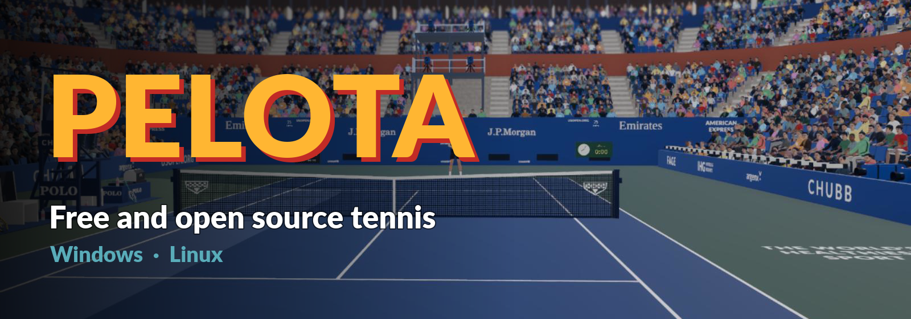
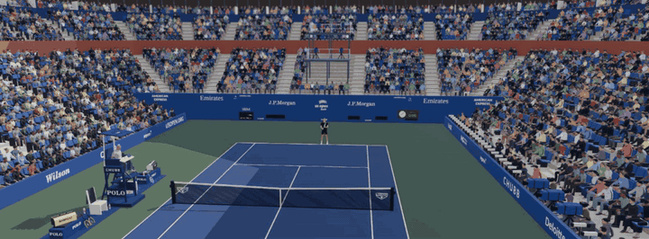
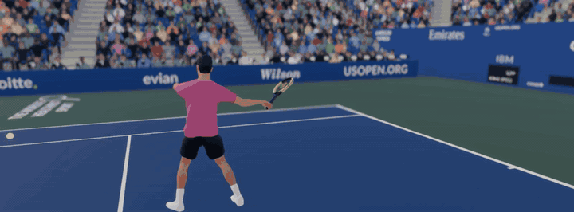
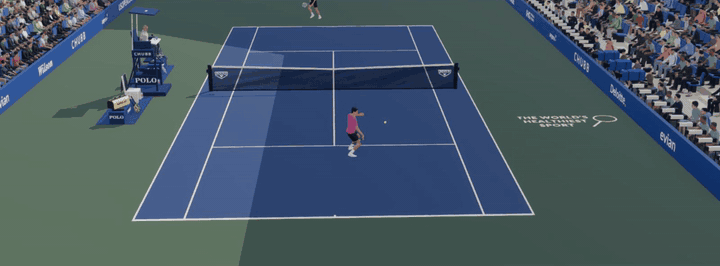
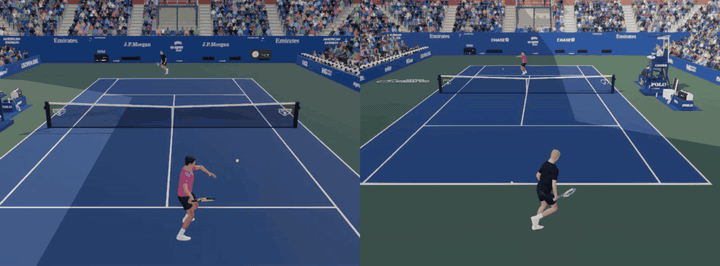

### Time your shots. Spin the ball. Beat the CPU, or a friend on the same couch.

**A free, open source 3D tennis game. No sign-up, no ads, no purchases, no internet needed.**

[**Website**](https://mbkma.github.io/pelota-website/) &nbsp;·&nbsp;
[**Documentation**](https://mbkma.github.io/pelota-docs/) &nbsp;·&nbsp;
[**How to play**](https://mbkma.github.io/pelota-docs/docs/play/) &nbsp;·&nbsp;
[**Report a bug**](https://github.com/mbkma/pelota/issues)

 

 

| | |
| --- | --- |
| **Genre** | Sports · Tennis simulation |
| **Price** | Free, forever |
| **Players** | 1–2 on one computer, with keyboard and gamepads |
| **Platforms** | Windows 10/11 · Linux (64-bit) |
| **Release** | Early alpha,  |
| **Developer** | [mbkma](https://github.com/mbkma) |
| **License** | Open source, [GPL-3.0](LICENSE) |

 

## ◇ WHY YOU'LL LIKE IT ◇

- **Easy to learn, hard to master.** Three shot buttons and a direction. Then it is all about timing.
- **Matches that feel like a broadcast.** A packed stadium, a chair umpire calling the score, TV graphics and camera cuts between points.
- **Play your way.** Quick match, a full 128-player tournament draw, or practice against a ball machine.
- **Play with friends.** Share a keyboard and a gamepad, or plug in several gamepads. Split screen included.
- **Scales to your PC.** Graphics presets from low to ultra, and a crowd you can thin out with a slider.
- **Yours to keep and change.** Open source: read the code, mod it, or help build it.

 

## ◇ TIME EVERY SHOT ◇

Hold a shot button to build power, release it just before the racket meets the ball. Topspin, slice or a
delicate drop shot: the better your timing, the smaller the circle where the ball can land, and a perfect
shot turns it gold, with extra pace and spin.

 

## ◇ A BALL THAT BEHAVES ◇

Spin bends the ball, topspin makes it kick off the court, a slice keeps it low, and the net cord can
decide a point. Hit it flat for pace or send it high and deep to push your opponent back.

## ◇ SERVE, VOLLEY, OUTLAST ◇

Serve flat, with slice or with kick. Close to the net, balls you take before the bounce are volleyed
for you. But pressure is real: break points and set points make you nervous, and running tires you
out, costing speed and accuracy. Calmer players cope better, so pick yours wisely.

 

## ◇ FIVE WAYS TO WATCH ◇

Switch the camera any time in the pause menu: **broadcast**, **elevated**, **courtside**, **overhead**, or
straight through your **player's eyes**.

 

## ◇ PLAY AGAINST A FRIEND ◇

In the player selection, move your keyboard or gamepad to the left or right side to take that player.
Any player without a device is played by the CPU, so a two player match is just a button away.
With two people playing, press `X` on the keyboard during a match to switch between one view, side by side and top and bottom split screen.

 

## ◇ FROM A QUICK MATCH TO THE FINAL ◇

- **Quick match:** pick any two players and play a best of three sets.
- **Tournament:** a 128-player draw over seven rounds, with matches over three or five sets. Play your matches, or simulate them and watch the draw fill up. Your progress is saved.
- **Training:** a ball machine feeds you a ball whenever you ask for the next one, so you can practice any shot in peace.

 

## ◇ CONTROLS ◇

| | Keyboard | Gamepad |
| --- | --- | --- |
| Move | `W` `A` `S` `D` or arrow keys | Left stick or D-pad |
| Topspin shot / flat serve | `Space` | `A` |
| Slice shot / slice serve | `Shift` | `X` |
| Drop shot / kick serve | `Ctrl` | `Y` |
| Pause | `Esc` | `Start` |

The in-game **How to Play** page walks you through it, and the
[documentation](https://mbkma.github.io/pelota-docs/docs/play/) has the details.

 

## ◇ PLAY IT IN THREE STEPS ◇

1. **Download** the Windows (`.zip`) or Linux (`.tar.gz`) file of the [latest release](https://github.com/mbkma/pelota/releases/latest) (about 200 MB), or see all [releases](https://github.com/mbkma/pelota/releases).
2. **Unpack** it anywhere.
3. **Run** `Pelota.exe` (Windows) or `Pelota.x86_64` (Linux). Nothing to install.

> Windows may warn about an unknown publisher the first time, because the game is not code signed.
> Choose "More info", then "Run anyway".

**Requirements:** 64-bit Windows 10/11 or Linux, a graphics card with Vulkan support (or Direct3D 12 on
Windows), and a keyboard or a gamepad. If it runs slowly, lower the graphics preset in the options.

 

## ◇ AN EARLY ALPHA, BUILT IN THE OPEN ◇

Pelota is young: expect rough edges and missing features. That is also the fun part. Every bug report,
idea and pull request shapes where it goes next.

- **Found a bug or have an idea?** [Open an issue](https://github.com/mbkma/pelota/issues).
- **Want to see how it works?** The [documentation](https://mbkma.github.io/pelota-docs/docs/how-it-works/) explains the game inside.
- **Want to help?** Read how to [contribute](https://mbkma.github.io/pelota-docs/docs/contribute/).
- **Like it?** Tell a friend, and give the repository a star.

 

## Build from source

Open this folder in [Godot](https://godotengine.org/download) (the version in `config/features` of
`project.godot`) and press F5. `tools/release.sh` builds the release archives for Linux and Windows.

## Credits and license

Pelota is free software under the [GPL-3.0 license](LICENSE). The music, models, sounds and other assets
are credited in [ATTRIBUTION.md](ATTRIBUTION.md).

The trailer and the pictures above were filmed in the game, with scripted cameras replaying real
matches between CPU players. The camera views you can choose in the game are the five listed above.
